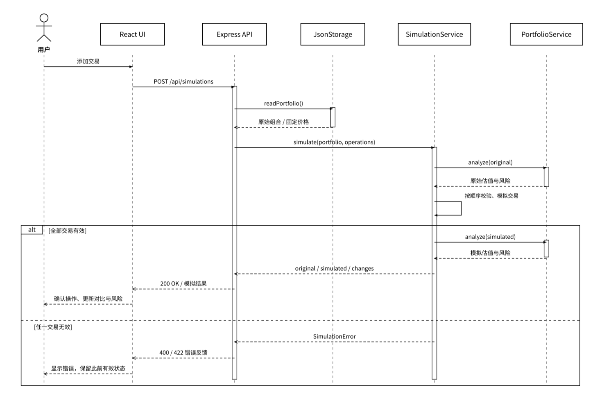
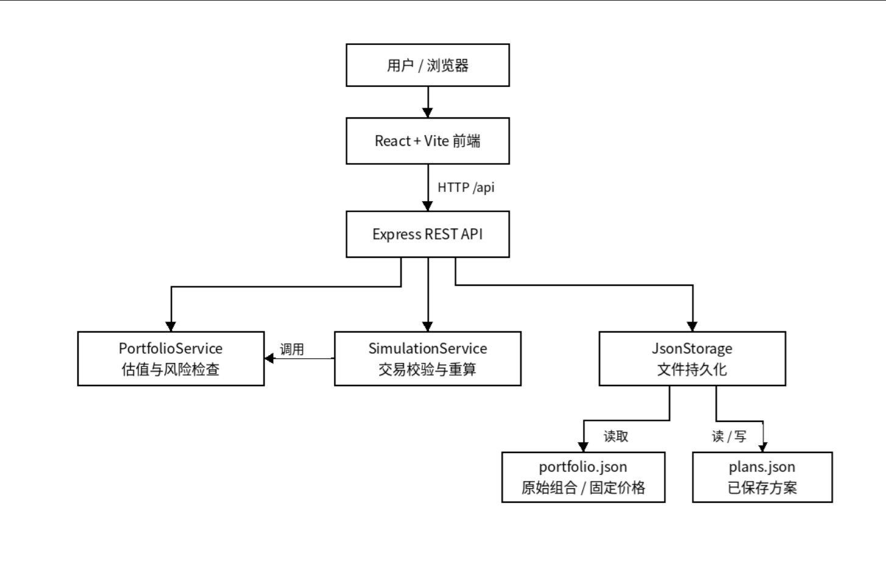

# DESIGN.md — 投资组合分析与调仓模拟

## 1. 需求与交互设计

**核心流程**：组合概览 → 集中度检查 → 顺序调仓模拟 → 前后对比 → 方案保存与重开。

**页面设计**：采用单页面工作台，划分为组合概览、持仓风险提示、调仓模拟、结果对比和方案管理五个功能模块。

组合概览始终展示原始投资组合，包括总资产、现金、持仓明细、行业分布及行情快照时间。模拟交易不会修改原始组合。

调仓对比采用单表差异展示，集中呈现原始与模拟后的持仓数量、市值、占比及变化情况，现金与行业配置变化单独展示。

持仓风险提示独立于原始组合概览，仅展示当前查看状态下的超限情况：未模拟时展示原始组合风险，模拟成功后展示模拟结果风险，打开已保存方案时展示该方案重算后的风险。不重复展示两组报警，避免用户误解。

**交互状态**：

- 加载中：展示加载提示，并在接口失败时提供明确错误和重试入口。
- 无交易：展示原始组合及空操作状态，禁止保存空方案。
- 交易成功：更新有效操作序列和模拟结果。
- 交易失败：展示用户可理解的错误信息，保持原有效结果不变。
- 方案管理：支持命名、保存及重新打开，提供保存反馈和无历史方案时的空状态。
- 已保存方案：以只读方式展示交易序列与重算结果，不允许直接修改。
- 页面刷新：未保存的模拟状态重置，已持久化的方案可从列表重新打开。

**验收范围**：实现 FR-01 至 FR-05，通过 AC-01 至 AC-05 验证核心业务流程。

**功能边界**：单用户、单组合、单币种（CNY），仅支持给定标的及固定价格。不涉及真实下单、实时行情、手续费、税费、分红、融资、卖空或多用户认证。

## 2. 数据模型与状态管理

### 2.1 核心数据模型

系统包含以下数据对象：

| 数据对象 | 核心字段 | 职责 |
|---|---|---|
| Portfolio | portfolio_id、cash、instruments | 原始投资组合及持仓 |
| Snapshot | snapshot_id、snapshot_at、price | 固定行情基准 |
| Trade | type、symbol、quantity | 单笔模拟买卖操作 |
| SavedPlan | id、name、snapshot_id、operations | 已保存的调仓方案 |
| SimulationResult | original、simulated、changes | 原始组合、模拟组合及变化结果 |

Portfolio 与 Snapshot 在逻辑上区分，实际使用任务提供的同一份 JSON 数据，无需额外拆分存储。

SavedPlan 使用唯一 ID 区分方案，允许名称重复。交易操作按数组顺序保存，以保证模拟执行顺序一致。

模拟结果作为派生数据，不单独持久化，避免与原始组合及交易记录产生不一致。

### 2.2 模拟状态管理

采用无服务端会话的完整交易序列重算机制。

1. 前端维护当前已通过校验的交易操作序列及模拟结果。
2. 新增交易时，前端将完整候选操作序列发送至后端。
3. 后端基于原始组合与固定行情快照，依次校验并执行操作，计算模拟结果。
4. 校验成功后，前端更新有效操作序列及展示结果；校验失败则保留此前有效状态，并展示错误信息。

所有计算均在独立模拟状态中执行，原始组合保持不变。

由于后续交易依赖前序结果，交易顺序不可交换。例如，先卖出部分持仓取得现金，再使用现金买入，可能成功；反向执行则可能因现金不足失败。

### 2.3 方案持久化与恢复

采用本地 JSON 文件保存方案 ID、名称、关联快照 ID 及有序交易操作序列，不重复存储资产市值、占比等派生计算结果。

- **保存**：仅允许保存至少包含一笔有效交易的方案；后端重新校验操作序列后持久化。
- **重开**：读取保存的操作序列，基于对应快照和原始组合重新计算，展示历史方案的操作及最终结果。
- **状态隔离**：已保存方案以只读方式查看，不支持直接编辑；模拟操作不会修改原始组合。
- **持久化保证**：刷新页面或重启服务后，方案文件仍可读取，重新计算的结果与保存前保持一致。

保存时先将更新后的方案列表写入同目录临时文件，成功后重命名替换正式文件，降低直接覆盖过程中断造成文件损坏的风险。

### 2.4 设计取舍与扩展边界

当前采用完整序列重算，以少量重复计算换取更简单的状态管理和可复现性。随着交易数量增长，计算和数据传输成本会增加。

本地 JSON 存储能够满足单用户原型需求，但不适合直接用于多用户并发写入场景。

为降低后续修改成本，已将模拟计算、API 请求处理和持久化逻辑分离。当前不实现增量计算、缓存或多用户数据库支持，后续根据实际需求和性能验证结果再考虑扩展。

## 3. 系统架构与接口设计

### 3.1 系统架构

采用 React + Vite、Node.js + Express 前后端分离架构，通过 REST API 通信。

后端按照 API、Service、Storage 划分职责：

- **API 层（src/app.js）**：处理 HTTP 请求、参数校验、业务服务调用及统一错误响应。
- **PortfolioService**：负责组合估值、总资产、持仓占比、行业配置及集中度检查。
- **SimulationService**：负责交易约束校验、顺序模拟及调仓前后对比。
- **Storage 层（JsonStorage）**：读取原始组合及行情快照，管理已保存方案的 JSON 持久化。

核心模拟逻辑独立于 HTTP 和存储模块，供模拟、保存、重开及自动化测试复用。

前端负责用户输入、状态管理与结果展示；后端统一计算资产、集中度及调仓变化量，避免前后端计算口径不一致。

### 3.2 REST API 设计

| 方法 | 接口 | 主要输入与输出 |
|---|---|---|
| GET | `/api/portfolio` | 返回原始组合、资产统计及集中度 |
| POST | `/api/simulations` | 输入快照 ID、有序交易序列；返回模拟结果及完整前后对比 |
| POST | `/api/plans` | 输入方案名称、快照 ID、操作序列；返回方案 ID |
| GET | `/api/plans` | 返回已保存方案列表 |
| GET | `/api/plans/:id` | 返回指定方案及重新计算的模拟结果 |

模拟接口不持久化数据；保存接口重新校验完整交易序列后写入文件。方案重新打开时复用模拟计算逻辑。

**计算职责**：后端统一计算资产、持仓占比、行业集中度及调仓前后的变化量；前端仅负责展示，不重复实现核心业务计算。

### 3.3 校验与错误处理

后端统一校验交易标的、操作类型、正整数数量、现金及持仓约束，交易价格以固定行情快照为准。

采用统一错误响应格式，包含错误码、错误描述及适用时的交易序号：

- **400 Bad Request**：参数缺失、格式错误、无效快照或非法交易数量。
- **422 Unprocessable Entity**：现金不足、持仓不足等业务约束失败。
- **404 Not Found**：指定方案不存在。
- **500 Internal Server Error**：文件读取、写入等服务端异常。

模拟校验失败时不更新此前有效的交易序列及模拟结果；方案持久化失败时不返回保存成功。

前端对内部错误信息进行用户友好化处理，只展示必要的失败原因，不直接暴露错误码及不必要的交易序号。

## 4. 核心计算与异常处理

### 4.1 计算与精度

后端按照任务书规定的估值公式计算标的市值、总资产、持仓占比及行业集中度。

- 标的市值 = 快照价格 × 持仓数量。
- 总资产 = 现金余额 + 全部标的市值之和。
- 标的占比 = 标的市值 ÷ 总资产。
- 行业占比 = 同行业标的市值之和 ÷ 总资产。

现金计入总资产分母，不归入行业。

使用 Decimal.js 处理金额与比例运算，内部保留计算精度，仅在输出展示时保留两位小数。

单一标的占比严格大于 30%、行业占比严格大于 50% 时触发提醒，等于阈值不触发。

集中度使用展示舍入前的比例进行比较，避免实际占比超过阈值但显示结果仍为 30.00% 时出现错误判断。

### 4.2 交易校验与异常隔离

模拟引擎从原始组合创建独立计算状态，按顺序执行交易，后续操作基于前序计算结果。

每笔交易校验标的有效性、买卖类型、正整数数量及现金、持仓约束，价格统一从固定快照读取。

采用候选序列整体校验策略：全部通过后返回模拟结果；任一操作失败则返回错误及对应交易序号，不确认本次候选序列，保留此前有效结果。

这一策略同时保证原始组合数据不变，以及失败交易不会破坏前端已经确认的模拟状态。

### 4.3 计算验证与异常边界

以 AC-01 至 AC-04 验证初始估值、阈值边界、连续交易及无效操作；以 AC-05 验证方案恢复及数据隔离。

同时验证以下不变量：

- 固定价格、无交易费用条件下，总资产保持不变。
- 现金及持仓数量不得为负。
- 模拟交易不得修改原始组合。
- 校验失败不得改变此前已确认的模拟结果。

在任务书基础上，额外补充三个针对性测试：

- **T-01 顺序依赖**：比较先卖后买与先买后卖，验证执行顺序对结果的影响。
- **T-02 精度边界**：构造实际占比 29.999% 和 30.001%，两者均显示为 30.00%，但仅后者触发提醒。
- **T-03 失败隔离**：连续两笔有效交易后追加一笔超量卖出，验证失败后此前有效结果保持不变。

对于当前数据集以外的异常情况，若行情价格缺失则应拒绝相关估值或模拟并提示数据异常；若行业信息未知，应明确标记并提示行业集中度结果可能不完整，避免静默给出误导性结论。上述情况仅作为设计边界说明，MVP 不额外实现。

## 5. 关键设计决策与取舍

### 5.1 模拟计算策略

**备选方案**：增量更新模拟状态 / 基于完整交易序列重新计算。

**最终选择**：完整序列重算。

**决策依据**：当前为单用户、单组合及少量交易场景，重复计算成本较低。完整重算无需维护服务端模拟会话，便于状态隔离、结果复现及自动化测试。

在设计讨论中，同时考虑了未来大量交易情况下的维护成本。因此将模拟引擎独立封装，避免计算逻辑与路由和持久化层直接耦合。

**局限与扩展**：交易数量增长会增加重复计算与数据传输成本。未来可在保留接口语义的基础上考虑增量计算或缓存。

### 5.2 数据持久化策略

**备选方案**：本地 JSON 文件 / SQLite 数据库。

**最终选择**：本地 JSON 文件，并采用临时文件写入与重命名替换机制。

**决策依据**：当前业务无需复杂查询和多用户管理，JSON 能减少开发及运行成本。保存时先在同一目录写入临时文件，成功后重命名替换正式文件，降低写入中断造成文件损坏的风险。

此外，仅保存交易操作而非派生计算结果，可避免多份资产数据产生不一致，重开时使用相同业务逻辑重新计算。

**局限与扩展**：该机制不能保证并发写入安全或完整的断电持久性。未来出现多用户、并发写入等需求时，再考虑引入数据库。

### 5.3 页面组织与风险提示

**备选方案**：多页面 Dashboard / 单页面工作台；原始与模拟风险同时展示 / 仅展示当前状态风险。

**最终选择**：单页面工作台，数值保留前后对比，风险提示独立展示当前状态。

**决策依据**：本项目只有六个标的，单页面可以减少操作跳转，使用户直接查看模拟变化。

在人工验收中发现，原始组合和模拟组合的风险报警同时出现时，即使模拟已经解除超限，原始风险仍容易被理解为当前风险。

因此保留原始与模拟数据的完整数值对比，但将风险提醒从原始组合概览中独立出来，只显示当前查看方案的风险状态。

同时，组合概览固定展示原始资产，避免将模拟交易误认为真实成交。

**局限与扩展**：单页面包含较多数据，大规模持仓场景可能需要筛选、排序、分页或更细化的页面组织。本次不额外增加这些功能。

## 6. AI 协作记录

本项目使用 Codex 辅助实现代码与自动化测试，使用 ChatGPT 辅助需求分析、设计讨论、代码与结果核验，以及文档整理。

本人负责确认业务规则、选择设计方案、判断 AI 输出是否符合要求，并执行实际验收。

### 6.1 协作案例一：完整序列重算策略

**问题与上下文**：如何在顺序交易场景下保证模拟结果可复现，同时避免无效交易污染已确认状态？如果未来出现大量交易，完整重算是否难以维护？

**AI 建议**：比较增量状态更新与完整序列重算，分析各自的计算成本、状态管理复杂度和可复现性。

**人工判断**：当前少量交易适合完整重算，但需要考虑未来维护成本和模块替换能力。

**最终决策**：采用完整序列重算，核心计算逻辑独立封装，不提前引入服务端会话与缓存。

**后续核验**：检查模拟、保存、重开能否复用同一计算逻辑，并通过 T-01 顺序依赖测试及 T-03 失败隔离测试验证。

### 6.2 协作案例二：自动化测试与边界验证

**问题与上下文**：Codex 已完成核心服务与原有自动化测试，但仅依赖 AI 编写的测试，可能遗漏部分业务边界。

**AI 输出**：Codex 编写 AC-01～AC-05 及异常处理相关测试；ChatGPT 根据现有测试范围提出额外边界场景，并辅助编写部分测试断言。

**人工检查与修改**：在原有测试之外，主动验证交易顺序依赖、舍入前阈值判断和第三笔失败后的状态隔离。

**实际结果**：后端及 API 阶段，本人在本地执行 `npm test`，共 11 项测试通过、0 项失败。其中 Codex 原有测试 8 项，人工主导补充测试 3 项。

**采用依据**：T-01、T-02、T-03 检查了对状态可靠性和金额判断具有实际影响的边界，作为原有验收测试的补充。

### 6.3 协作案例三：前端人工验收与设计修正

**问题与上下文**：前端功能完成后，需要确认页面不仅符合计算结果，还能让普通用户准确理解模拟交易的含义。

**AI 输出**：Codex 实现前端页面及交互；ChatGPT 根据验收用例协助检查数据、风险提醒和页面状态，并提出调整建议。

**人工检查与修改**：在浏览器实际操作中发现，原始与模拟风险重复展示容易造成误解；部分提示直接使用技术术语，且展示层级不够清晰。

经过讨论，明确以下最终设计：

- 组合概览始终保持原始数据。
- 模拟后的资产变化集中在前后对比区域。
- 风险提醒只展示当前查看状态的结果。
- 用户错误反馈使用自然语言，不暴露不必要的内部字段。

**实际核验**：人工执行组合查看、顺序交易、无效交易、方案保存及服务重启后恢复，并保存九张浏览器截图。

**采用依据**：以业务规则、用户可理解性和验收结果为依据，而不是直接接受 AI 的初次界面设计建议。具体操作与截图见 `VERIFY.md`。

## 7. 完成情况与复盘

### 7.1 完成情况

| 功能 | 当前状态 |
|---|---|
| FR-01 原始组合概览 | 已完成 |
| FR-02 集中度检查 | 已完成 |
| FR-03 顺序调仓及前后对比 | 已完成 |
| FR-04 方案保存、重开及原始组合隔离 | 已完成 |
| FR-05 后端计算、约束校验与错误反馈 | 已完成 |
| 后端及 API 自动化测试 | 11 项已通过 |
| 前端交互与浏览器人工验收 | 已完成主要流程验收并保存截图 |
| 干净环境克隆与交付复现 | 最终验证中 |

人工验收截图覆盖 AC-01～AC-05，包括初始组合、阈值边界、连续交易、失败反馈和保存方案恢复。

已保存方案在实际停止并重新启动后端服务后，仍可从列表打开并恢复相同模拟结果。

具体测试步骤、实际数值、测试来源及证据文件见 `VERIFY.md`。

### 7.2 与初始 PLAN 的差异

总体技术栈、数据模型和核心实现范围与初始 PLAN 保持一致。

开发过程中主要产生以下调整：

1. 在 JSON 持久化中增加临时文件写入及重命名机制，降低文件覆盖风险。
2. 根据人工验收结果重新划分组合概览、数值对比与风险提示的展示职责。
3. 优化行情时间和错误反馈文案，减少面向普通用户的技术细节。
4. 在既有 AC-01～AC-05 测试之外，补充三项人工主导的边界测试。

上述调整主要提高可靠性、可验证性和可理解性，没有增加任务范围之外的业务功能。

### 7.3 未完成项、已知限制与风险

**未纳入 MVP 的功能**：实时行情、多用户认证、并发写入控制、手续费、税费、融资、卖空及真实交易。

**已知技术限制**：JSON 存储不适合并发写入；完整序列重算在长交易序列下有重复计算成本；当前测试和界面主要针对规定的固定数据集。

**交付验证**：最终 README 的全新克隆、依赖安装和启动复现需以实际执行结果为准，不以当前开发机器可运行为唯一依据。

### 7.4 复盘与后续改进

通过实际浏览器验收发现，数据计算正确不代表界面信息一定容易理解。因此，在保证业务正确性的基础上，需要进一步检查信息是否适合面向用户，语义是否有错误以及错误反馈是否清晰，方便后续的维护。

如果额外增加一小时，将优先完成干净环境的完整安装与运行回归，增强UI的清晰度，保证用户使用体验，例如增加功能提示词，增强网站的可理解性；并考虑补充浏览器端到端自动化测试。
